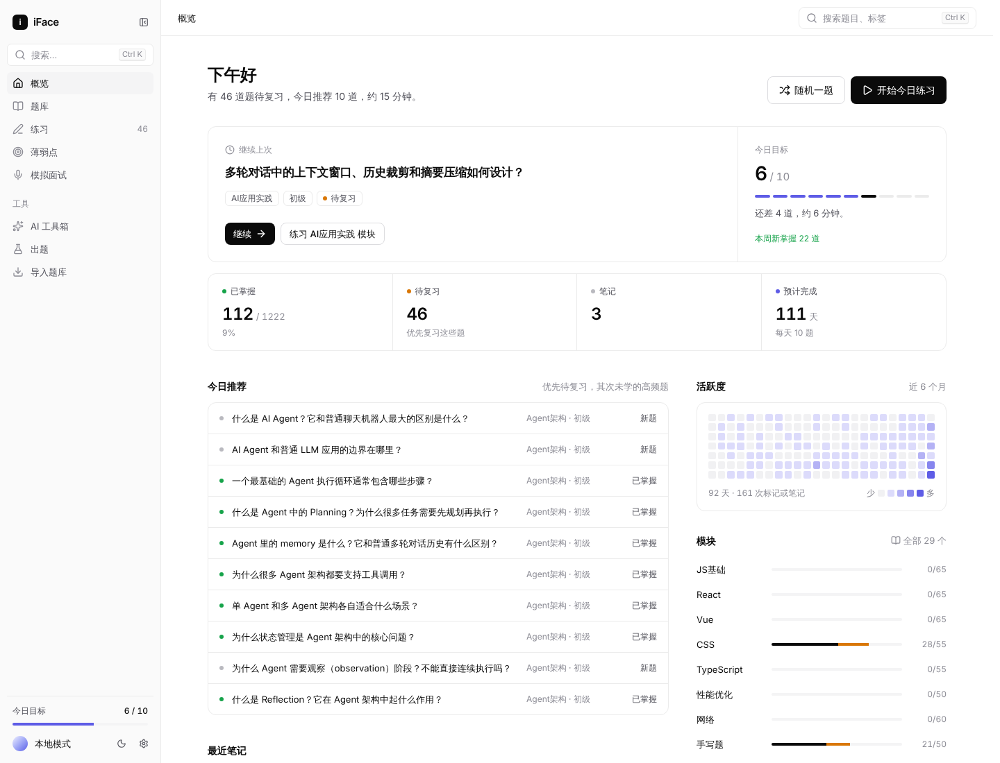
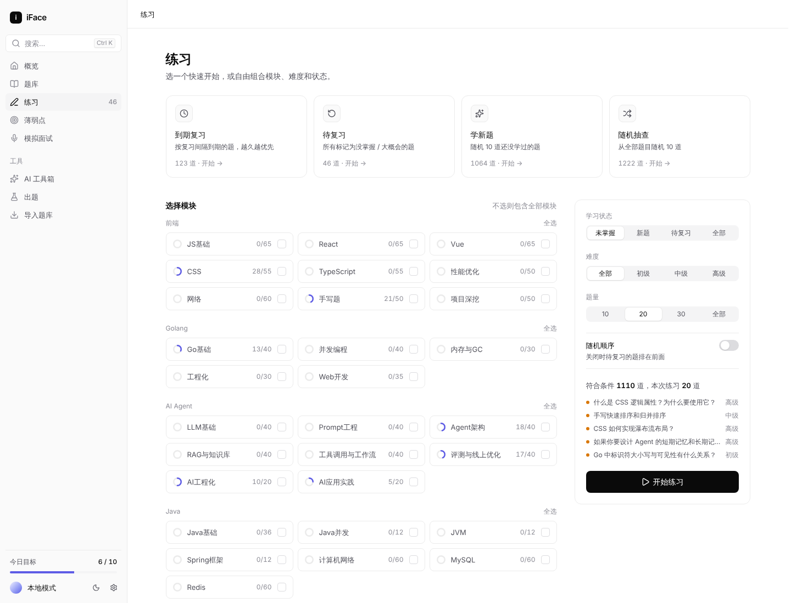
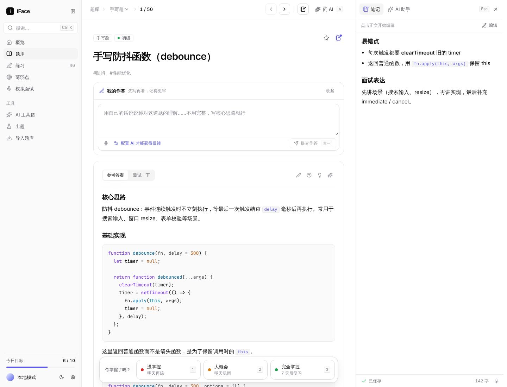
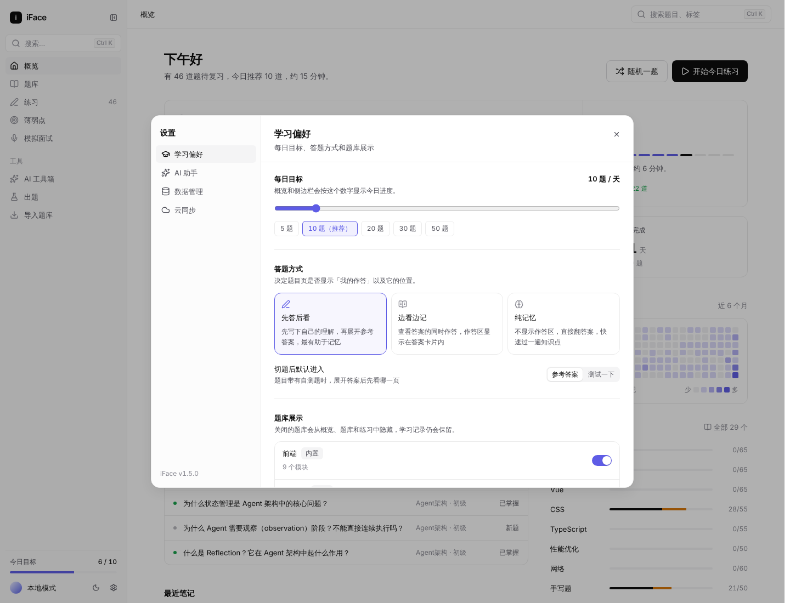

> [!TIP]
> 近期没有新更新，一是因为没有新内容需求，重心是老功能的维护；二是项目准备从 AGC（AI 生成内容）向 UGC（用户生成内容）进行转变，旨在提供更好的学习内容，同时会保留 AI 辅助相关功能。现在有 UGC 的社区版本已经测试上线 [➡️ QFace](https://github.com/dogxii/qface)，如果您感兴趣，欢迎使用体验以及提供宝贵的反馈。未来的版本将会是两者的融合升级，让我们期待它 👀。

<div align="center">

# 😎 iFace

**八股面试题库 · 智能刷题工具**

[立即体验](https://face.dogxi.me) · [报告问题](https://github.com/dogxii/iFace/issues) · [功能建议](https://github.com/dogxii/iFace/issues)


</div>

---

## 👀 预览

https://face.dogxi.me

<div align="center">
  
  
  <br/><br/>
  
  
</div>


## 📚 简介

iFace 是一款专为 前端/Agent/Golang 等工程师备战技术面试打造的本地刷题工具。题库、进度、AI 对话全部存储在浏览器本地，无需注册、无需服务器，打开即用。

**核心理念：** 不只是背题，而是真正理解——通过 AI 教练辅助、进度追踪和薄弱点分析，帮助你在面试中清晰表达。


## ⚡️ 功能特性

- 题库管理：内置前端 / Golang / Java / AI Agent 题库，支持 JSON 或 Markdown 导入，可直接粘贴 AI 生成的题目
- 智能刷题：按模块、难度、状态组合练习，先作答再看答案，附带选择题小测
- 间隔复习：根据掌握情况自动推算下次复习时间，到期题目集中出现在练习和薄弱点页
- 全局搜索：`⌘K` / `Ctrl K` 搜索题目、笔记和常用命令
- AI 面试教练：拆题、评分作答、追问，模拟面试，简历 JD 诊断，AI 出题 Prompt
- 数据与进度：全部保存在浏览器本地，支持导入导出备份和 GitHub Gist 同步
- 亮色 / 暗色主题，支持安装为 PWA 离线使用


## 🚀 快速开始

https://face.dogxi.me

线上版本，实时更新，支持 GitHub 登陆备份数据。

## 本地运行

```bash
# 克隆仓库
git clone https://github.com/dogxii/iFace.git
cd iFace

# 安装依赖（推荐 bun，也可用 npm/pnpm）
bun install

# 启动开发服务器
bun dev
```

访问 [http://localhost:5173](http://localhost:5173)。开发环境下打开 `/design` 可以查看全部组件和设计 token。

常用脚本：`bun run check`（Biome）、`bun run test`（Vitest）、`bun run test:e2e`（Playwright）、`bun run build`。

## 🧭 使用指南

### 导入题库

内置题库在首次打开时自动加载。导入自定义题目：

1. 进入侧边栏「**导入题库**」
2. 上传 `.json` / `.md` 文件，或直接粘贴内容（自动识别 JSON 和 Markdown）
3. 想让 AI 帮忙出题，可以在「**出题**」页复制现成的 Prompt，把 AI 的输出粘贴回导入页

<details>
<summary>自定义题库 JSON 格式</summary>

```json
[
  {
    "question": "请解释 JavaScript 中的事件循环机制",
    "answer": "事件循环是 JS 处理异步操作的核心机制...",
    "module": "JS基础",
    "difficulty": 2,
    "tags": ["异步", "事件循环", "宏任务", "微任务"]
  }
]
```

| 字段         | 类型        | 必填 | 说明                           |
| ------------ | ----------- | ---- | ------------------------------ |
| `question`   | string      | ✅   | 题目内容                       |
| `answer`     | string      | ✅   | 参考答案（支持 Markdown）      |
| `module`     | string      | ✅   | 所属模块                       |
| `difficulty` | 1 \| 2 \| 3 | ✅   | 难度：1 初级 / 2 中级 / 3 高级 |
| `tags`       | string[]    | —    | 标签（用于薄弱点聚合）         |

</details>

### 配置 AI 助手

1. 点击侧边栏底部的**齿轮图标**（或 `⌘K` 搜索「设置」）打开设置
2. 切换到「**AI 助手**」页签
3. 填入 API Key 和 Base URL，选择模型，保存
4. 在任意题目详情页即可开始与 AI 对话

> API Key 仅存储在本地浏览器，不会上传到任何服务器。

---

## 💰 赞赏项目

如果觉得这个项目对你有帮助，欢迎请我喝咖啡 ☕️

> 采取自愿原则, 收到的赞赏将用于提高开发者积极性和开发环境。

<div style="display:flex; gap:24px; align-items:center;">
  
  
</div>

## 🪪 License

[MIT](LICENSE) © 2026 Dogxi
